<picture>
<source media="(max-width: 600px)" srcset="./assets/workflows/circle-mobile.svg" />
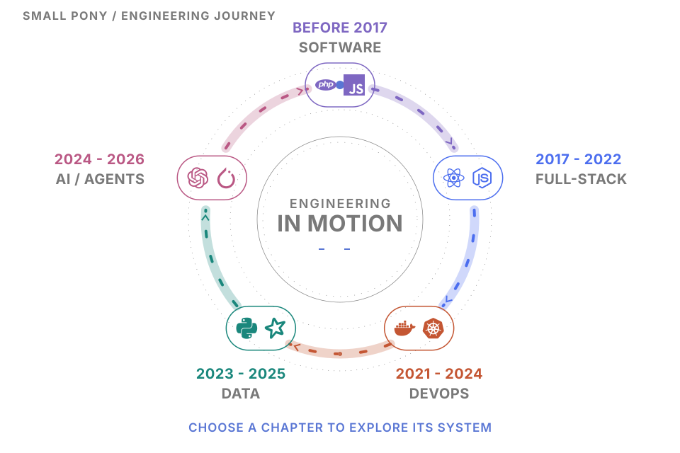
</picture>

<picture></picture> &nbsp; <strong>BEFORE 2017</strong> / Software engineering

<picture>
<source media="(max-width: 600px)" srcset="./assets/workflows/constellation-01-mobile.svg" />
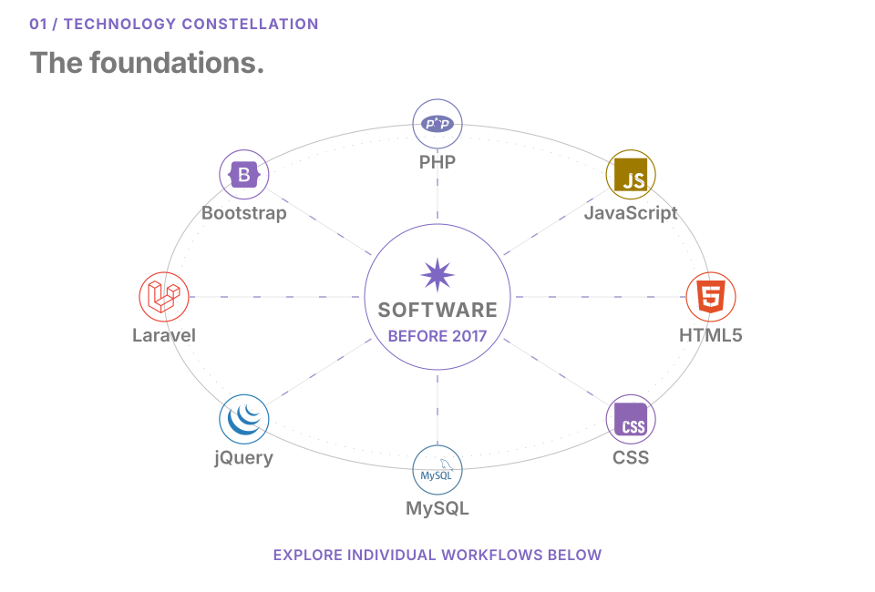
</picture>

<strong>Explore 8 technology workflows</strong>

<table width="100%" align="center">
<tbody>
<tr>
<td width="50%" align="center" valign="top">

<picture>
<source media="(max-width: 600px)" srcset="./assets/workflows/tile-php-mobile.svg" />

</picture> <strong>PHP</strong> Request lifecycle

<picture>
<source media="(max-width: 600px)" srcset="./assets/workflows/01-php-mobile.svg" />
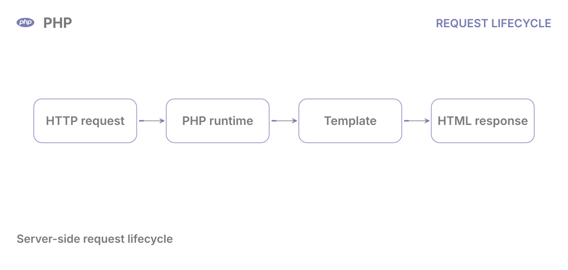
</picture>

</td>
<td width="50%" align="center" valign="top">

<picture>
<source media="(max-width: 600px)" srcset="./assets/workflows/tile-javascript-mobile.svg" />

</picture> <strong>JavaScript</strong> Event loop

<picture>
<source media="(max-width: 600px)" srcset="./assets/workflows/01-javascript-mobile.svg" />
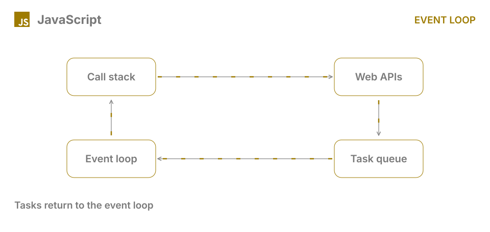
</picture>

</td>
</tr>
<tr>
<td width="50%" align="center" valign="top">

<picture>
<source media="(max-width: 600px)" srcset="./assets/workflows/tile-html5-mobile.svg" />

</picture> <strong>HTML5</strong> Document tree

<picture>
<source media="(max-width: 600px)" srcset="./assets/workflows/01-html5-mobile.svg" />
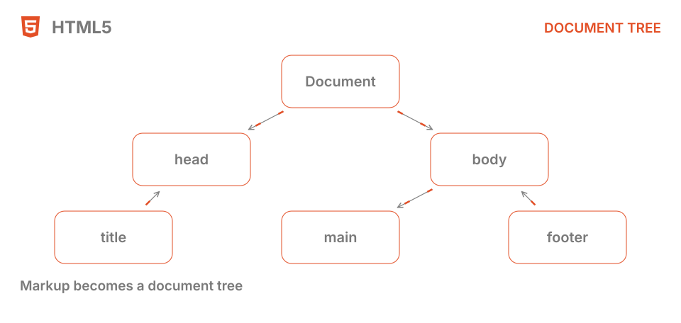
</picture>

</td>
<td width="50%" align="center" valign="top">

<picture>
<source media="(max-width: 600px)" srcset="./assets/workflows/tile-css-mobile.svg" />

</picture> <strong>CSS</strong> Style cascade

<picture>
<source media="(max-width: 600px)" srcset="./assets/workflows/01-css-mobile.svg" />
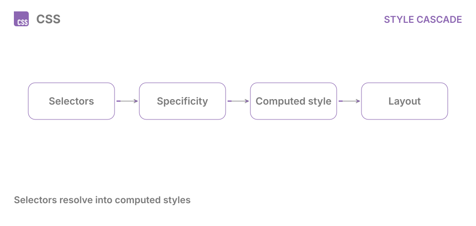
</picture>

</td>
</tr>
<tr>
<td width="50%" align="center" valign="top">

<picture>
<source media="(max-width: 600px)" srcset="./assets/workflows/tile-mysql-mobile.svg" />

</picture> <strong>MySQL</strong> Indexed reads

<picture>
<source media="(max-width: 600px)" srcset="./assets/workflows/01-mysql-mobile.svg" />
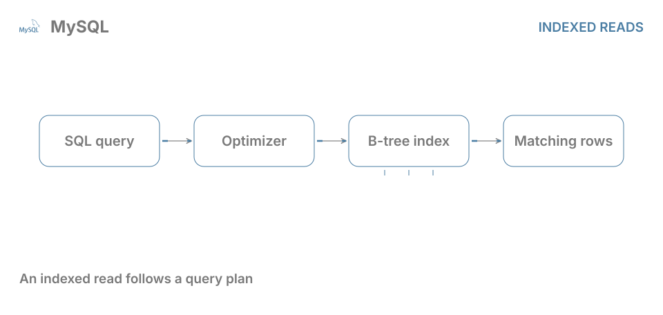
</picture>

</td>
<td width="50%" align="center" valign="top">

<picture>
<source media="(max-width: 600px)" srcset="./assets/workflows/tile-jquery-mobile.svg" />

</picture> <strong>jQuery</strong> DOM events

<picture>
<source media="(max-width: 600px)" srcset="./assets/workflows/01-jquery-mobile.svg" />
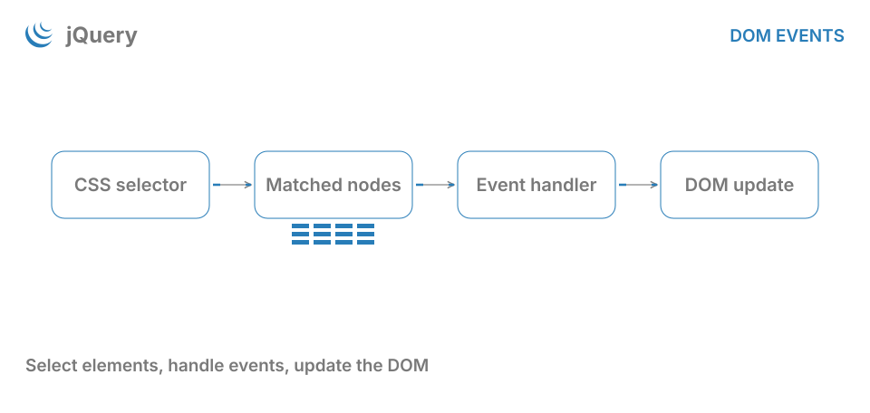
</picture>

</td>
</tr>
<tr>
<td width="50%" align="center" valign="top">

<picture>
<source media="(max-width: 600px)" srcset="./assets/workflows/tile-laravel-mobile.svg" />

</picture> <strong>Laravel</strong> Request pipeline

<picture>
<source media="(max-width: 600px)" srcset="./assets/workflows/01-laravel-mobile.svg" />
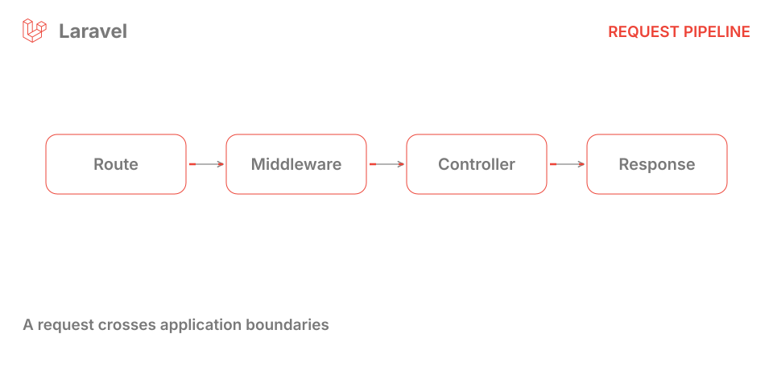
</picture>

</td>
<td width="50%" align="center" valign="top">

<picture>
<source media="(max-width: 600px)" srcset="./assets/workflows/tile-bootstrap-mobile.svg" />

</picture> <strong>Bootstrap</strong> Responsive grid

<picture>
<source media="(max-width: 600px)" srcset="./assets/workflows/01-bootstrap-mobile.svg" />
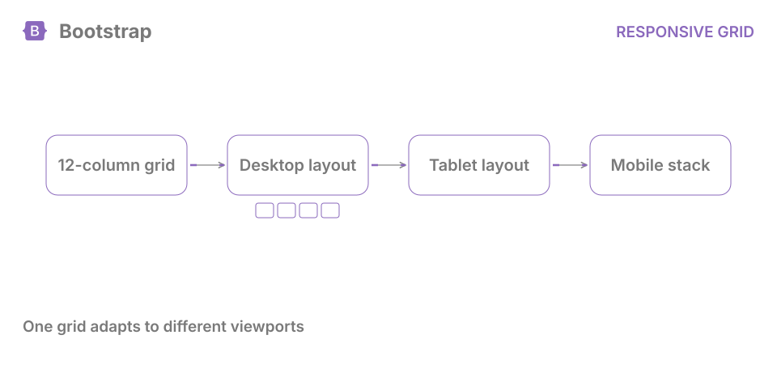
</picture>

</td>
</tr>
</tbody>
</table>

<picture></picture> &nbsp; <strong>2017 - 2022</strong> / Full-stack engineering

<picture>
<source media="(max-width: 600px)" srcset="./assets/workflows/constellation-02-mobile.svg" />
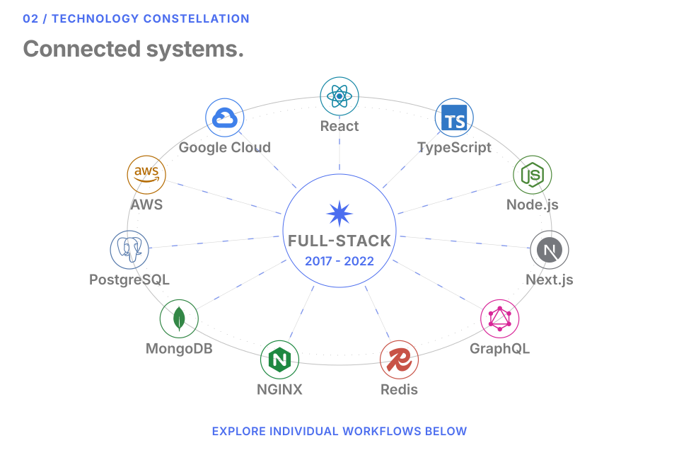
</picture>

<strong>Explore 11 technology workflows</strong>

<table width="100%" align="center">
<tbody>
<tr>
<td width="50%" align="center" valign="top">

<picture>
<source media="(max-width: 600px)" srcset="./assets/workflows/tile-react-mobile.svg" />

</picture> <strong>React</strong> State to DOM

<picture>
<source media="(max-width: 600px)" srcset="./assets/workflows/02-react-mobile.svg" />
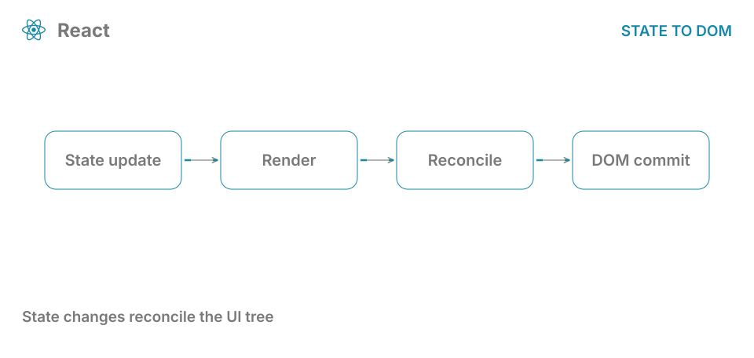
</picture>

</td>
<td width="50%" align="center" valign="top">

<picture>
<source media="(max-width: 600px)" srcset="./assets/workflows/tile-typescript-mobile.svg" />

</picture> <strong>TypeScript</strong> Type checking

<picture>
<source media="(max-width: 600px)" srcset="./assets/workflows/02-typescript-mobile.svg" />
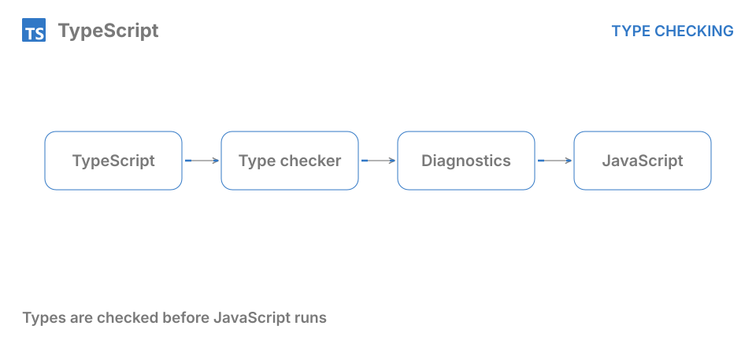
</picture>

</td>
</tr>
<tr>
<td width="50%" align="center" valign="top">

<picture>
<source media="(max-width: 600px)" srcset="./assets/workflows/tile-nodedotjs-mobile.svg" />

</picture> <strong>Node.js</strong> Async I/O

<picture>
<source media="(max-width: 600px)" srcset="./assets/workflows/02-nodedotjs-mobile.svg" />
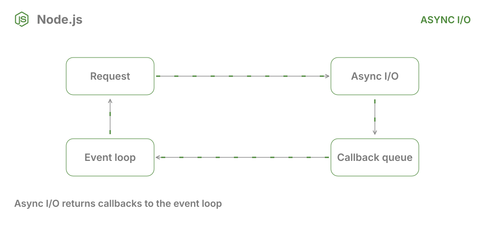
</picture>

</td>
<td width="50%" align="center" valign="top">

<picture>
<source media="(max-width: 600px)" srcset="./assets/workflows/tile-nextdotjs-mobile.svg" />

</picture> <strong>Next.js</strong> Server and client rendering

<picture>
<source media="(max-width: 600px)" srcset="./assets/workflows/02-nextdotjs-mobile.svg" />
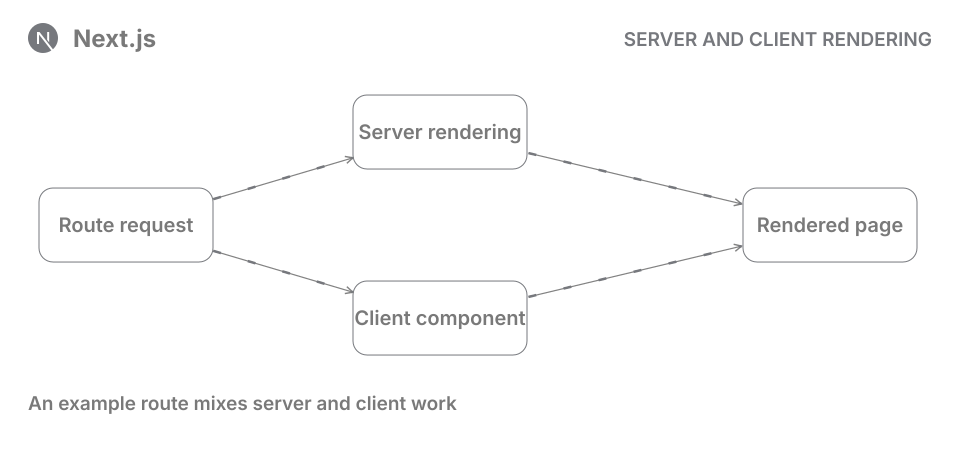
</picture>

</td>
</tr>
<tr>
<td width="50%" align="center" valign="top">

<picture>
<source media="(max-width: 600px)" srcset="./assets/workflows/tile-graphql-mobile.svg" />

</picture> <strong>GraphQL</strong> Field resolvers

<picture>
<source media="(max-width: 600px)" srcset="./assets/workflows/02-graphql-mobile.svg" />
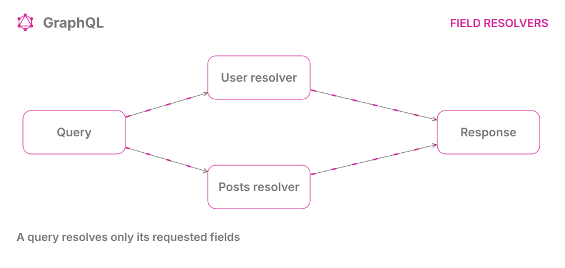
</picture>

</td>
<td width="50%" align="center" valign="top">

<picture>
<source media="(max-width: 600px)" srcset="./assets/workflows/tile-redis-mobile.svg" />

</picture> <strong>Redis</strong> Cache hit and miss

<picture>
<source media="(max-width: 600px)" srcset="./assets/workflows/02-redis-mobile.svg" />
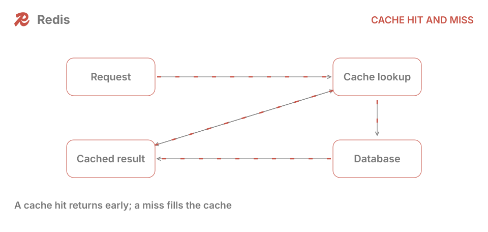
</picture>

</td>
</tr>
<tr>
<td width="50%" align="center" valign="top">

<picture>
<source media="(max-width: 600px)" srcset="./assets/workflows/tile-nginx-mobile.svg" />

</picture> <strong>NGINX</strong> Load balancing

<picture>
<source media="(max-width: 600px)" srcset="./assets/workflows/02-nginx-mobile.svg" />
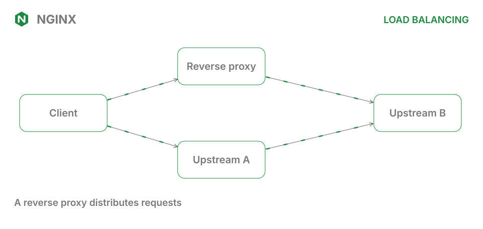
</picture>

</td>
<td width="50%" align="center" valign="top">

<picture>
<source media="(max-width: 600px)" srcset="./assets/workflows/tile-mongodb-mobile.svg" />

</picture> <strong>MongoDB</strong> Document queries

<picture>
<source media="(max-width: 600px)" srcset="./assets/workflows/02-mongodb-mobile.svg" />
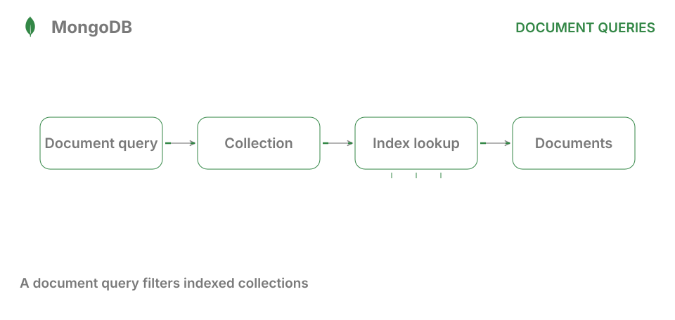
</picture>

</td>
</tr>
<tr>
<td width="50%" align="center" valign="top">

<picture>
<source media="(max-width: 600px)" srcset="./assets/workflows/tile-postgresql-mobile.svg" />

</picture> <strong>PostgreSQL</strong> Query planning

<picture>
<source media="(max-width: 600px)" srcset="./assets/workflows/02-postgresql-mobile.svg" />
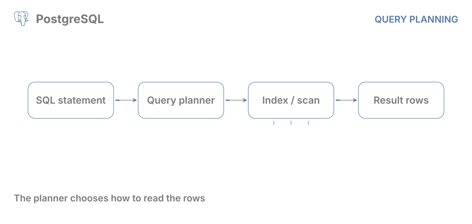
</picture>

</td>
<td width="50%" align="center" valign="top">

<picture>
<source media="(max-width: 600px)" srcset="./assets/workflows/tile-amazonwebservices-mobile.svg" />

</picture> <strong>AWS</strong> Web architecture

<picture>
<source media="(max-width: 600px)" srcset="./assets/workflows/02-amazonwebservices-mobile.svg" />
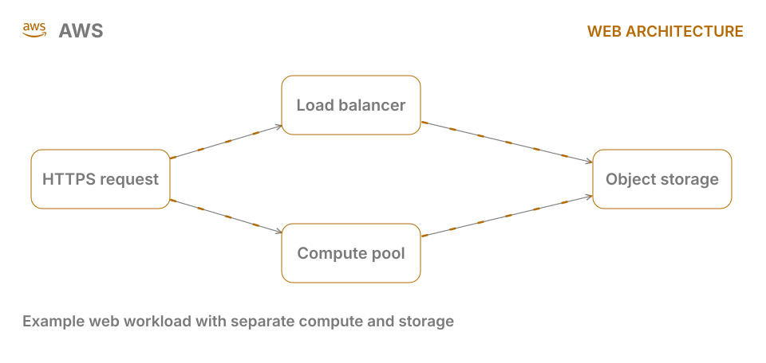
</picture>

</td>
</tr>
<tr>
<td colspan="2" align="center" valign="top">

<picture>
<source media="(max-width: 600px)" srcset="./assets/workflows/tile-googlecloud-mobile.svg" />

</picture> <strong>Google Cloud</strong> Event-driven services

<picture>
<source media="(max-width: 600px)" srcset="./assets/workflows/02-googlecloud-mobile.svg" />
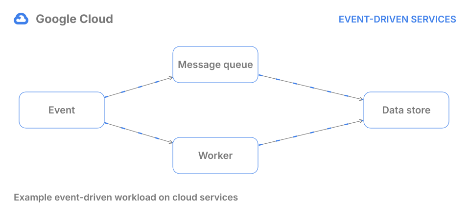
</picture>

</td>
</tr>
</tbody>
</table>

<picture></picture> &nbsp; <strong>2021 - 2024</strong> / DevOps and cloud

<picture>
<source media="(max-width: 600px)" srcset="./assets/workflows/constellation-03-mobile.svg" />
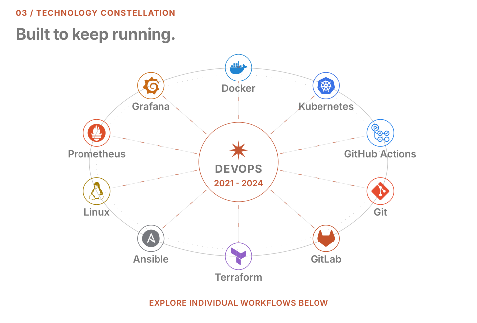
</picture>

<strong>Explore 10 technology workflows</strong>

<table width="100%" align="center">
<tbody>
<tr>
<td width="50%" align="center" valign="top">

<picture>
<source media="(max-width: 600px)" srcset="./assets/workflows/tile-docker-mobile.svg" />

</picture> <strong>Docker</strong> Image to containers

<picture>
<source media="(max-width: 600px)" srcset="./assets/workflows/03-docker-mobile.svg" />
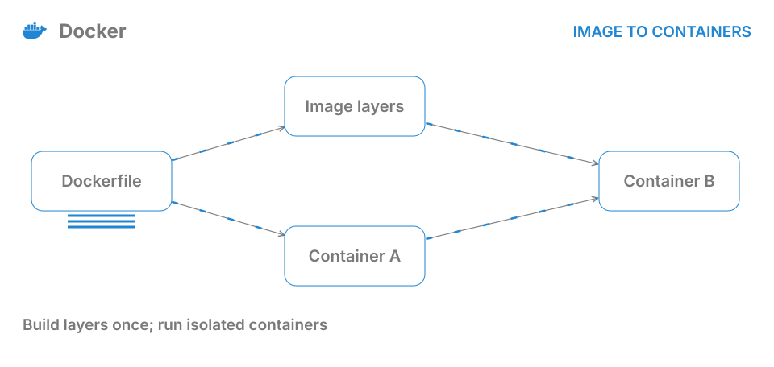
</picture>

</td>
<td width="50%" align="center" valign="top">

<picture>
<source media="(max-width: 600px)" srcset="./assets/workflows/tile-kubernetes-mobile.svg" />

</picture> <strong>Kubernetes</strong> State reconciliation

<picture>
<source media="(max-width: 600px)" srcset="./assets/workflows/03-kubernetes-mobile.svg" />
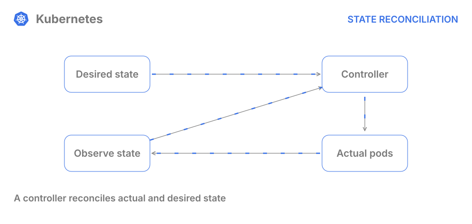
</picture>

</td>
</tr>
<tr>
<td width="50%" align="center" valign="top">

<picture>
<source media="(max-width: 600px)" srcset="./assets/workflows/tile-githubactions-mobile.svg" />

</picture> <strong>GitHub Actions</strong> CI/CD jobs

<picture>
<source media="(max-width: 600px)" srcset="./assets/workflows/03-githubactions-mobile.svg" />
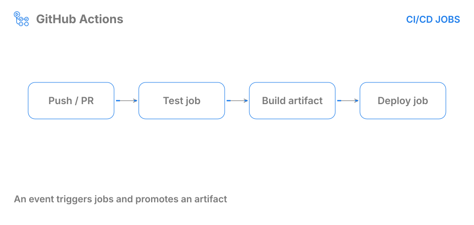
</picture>

</td>
<td width="50%" align="center" valign="top">

<picture>
<source media="(max-width: 600px)" srcset="./assets/workflows/tile-git-mobile.svg" />

</picture> <strong>Git</strong> Branch and merge

<picture>
<source media="(max-width: 600px)" srcset="./assets/workflows/03-git-mobile.svg" />
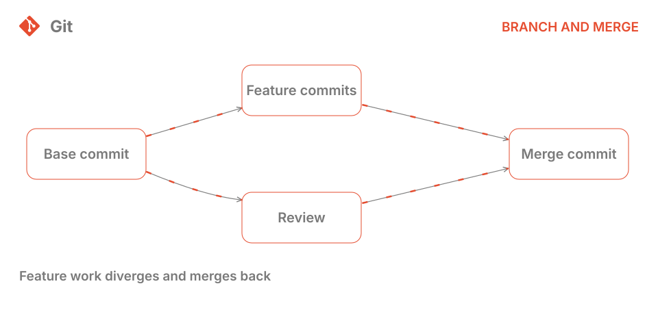
</picture>

</td>
</tr>
<tr>
<td width="50%" align="center" valign="top">

<picture>
<source media="(max-width: 600px)" srcset="./assets/workflows/tile-gitlab-mobile.svg" />

</picture> <strong>GitLab</strong> Build and deploy

<picture>
<source media="(max-width: 600px)" srcset="./assets/workflows/03-gitlab-mobile.svg" />
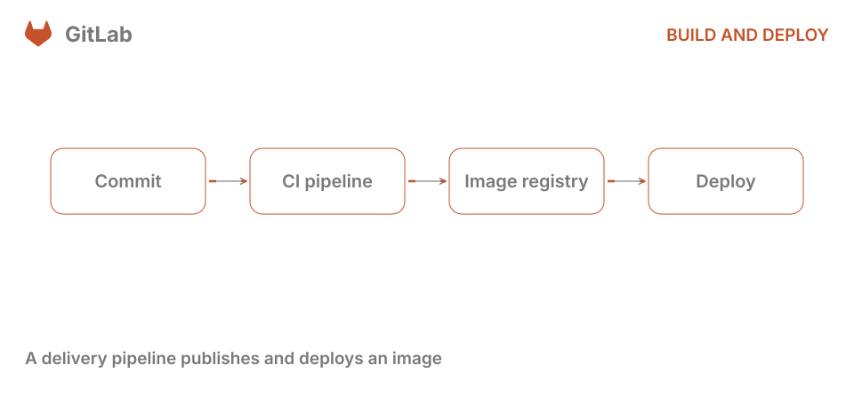
</picture>

</td>
<td width="50%" align="center" valign="top">

<picture>
<source media="(max-width: 600px)" srcset="./assets/workflows/tile-terraform-mobile.svg" />

</picture> <strong>Terraform</strong> Plan and state

<picture>
<source media="(max-width: 600px)" srcset="./assets/workflows/03-terraform-mobile.svg" />
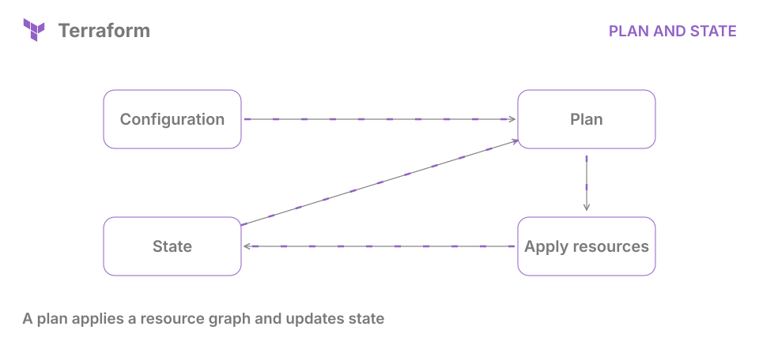
</picture>

</td>
</tr>
<tr>
<td width="50%" align="center" valign="top">

<picture>
<source media="(max-width: 600px)" srcset="./assets/workflows/tile-ansible-mobile.svg" />

</picture> <strong>Ansible</strong> Host convergence

<picture>
<source media="(max-width: 600px)" srcset="./assets/workflows/03-ansible-mobile.svg" />
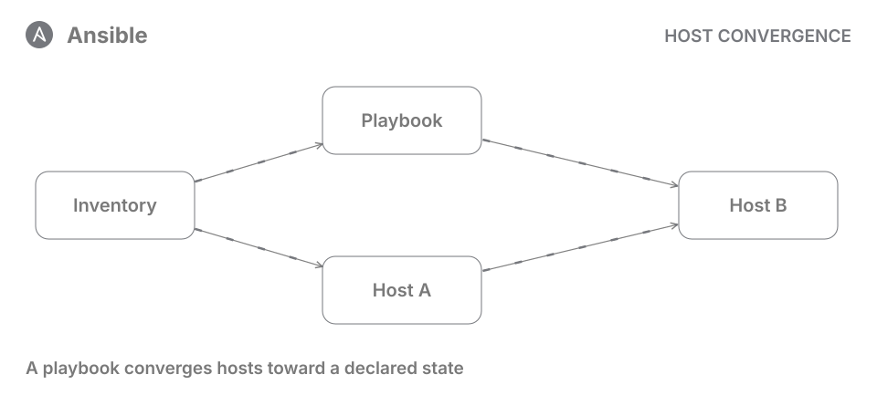
</picture>

</td>
<td width="50%" align="center" valign="top">

<picture>
<source media="(max-width: 600px)" srcset="./assets/workflows/tile-linux-mobile.svg" />

</picture> <strong>Linux</strong> User to kernel

<picture>
<source media="(max-width: 600px)" srcset="./assets/workflows/03-linux-mobile.svg" />
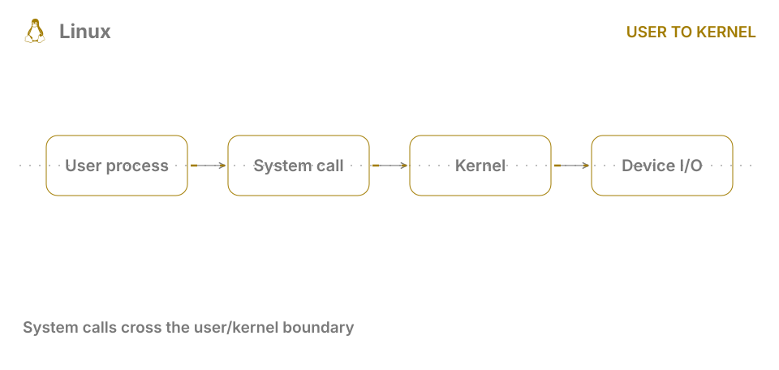
</picture>

</td>
</tr>
<tr>
<td width="50%" align="center" valign="top">

<picture>
<source media="(max-width: 600px)" srcset="./assets/workflows/tile-prometheus-mobile.svg" />

</picture> <strong>Prometheus</strong> Scrape and alert

<picture>
<source media="(max-width: 600px)" srcset="./assets/workflows/03-prometheus-mobile.svg" />
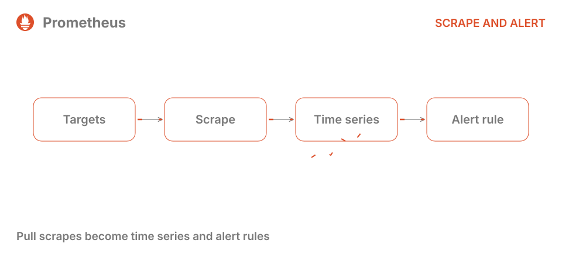
</picture>

</td>
<td width="50%" align="center" valign="top">

<picture>
<source media="(max-width: 600px)" srcset="./assets/workflows/tile-grafana-mobile.svg" />

</picture> <strong>Grafana</strong> Query to chart

<picture>
<source media="(max-width: 600px)" srcset="./assets/workflows/03-grafana-mobile.svg" />
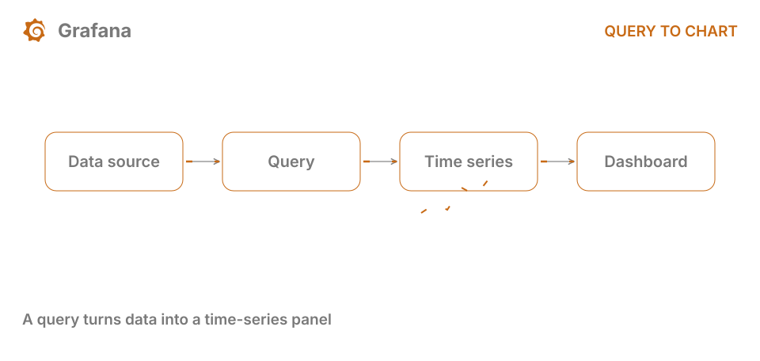
</picture>

</td>
</tr>
</tbody>
</table>

<picture></picture> &nbsp; <strong>2023 - 2025</strong> / Data engineering

<picture>
<source media="(max-width: 600px)" srcset="./assets/workflows/constellation-04-mobile.svg" />
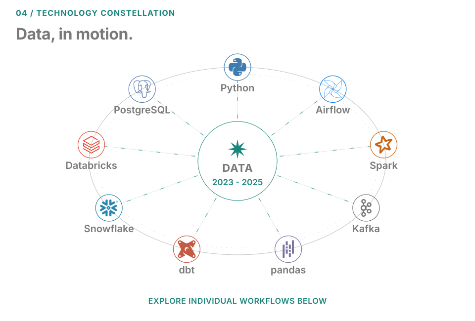
</picture>

<strong>Explore 9 technology workflows</strong>

<table width="100%" align="center">
<tbody>
<tr>
<td width="50%" align="center" valign="top">

<picture>
<source media="(max-width: 600px)" srcset="./assets/workflows/tile-python-mobile.svg" />

</picture> <strong>Python</strong> Data transformation

<picture>
<source media="(max-width: 600px)" srcset="./assets/workflows/04-python-mobile.svg" />
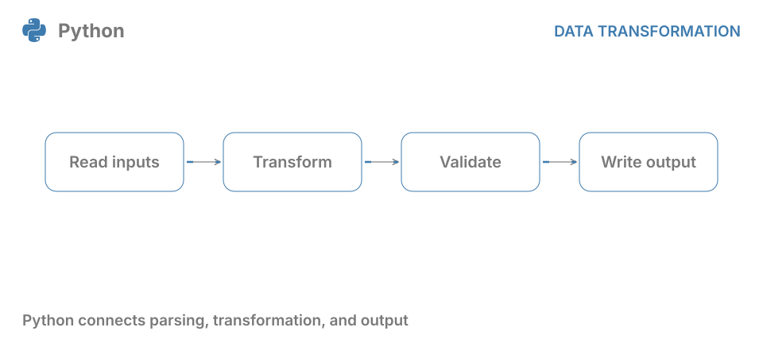
</picture>

</td>
<td width="50%" align="center" valign="top">

<picture>
<source media="(max-width: 600px)" srcset="./assets/workflows/tile-apacheairflow-mobile.svg" />

</picture> <strong>Airflow</strong> Task dependencies

<picture>
<source media="(max-width: 600px)" srcset="./assets/workflows/04-apacheairflow-mobile.svg" />
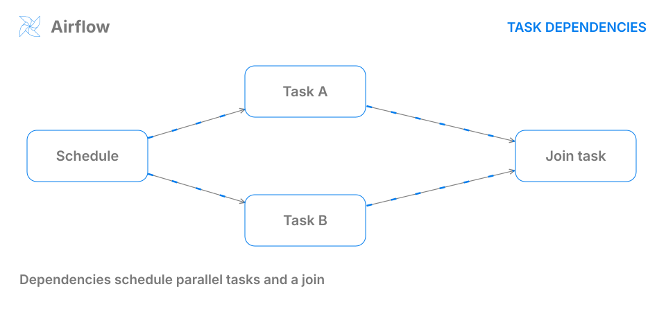
</picture>

</td>
</tr>
<tr>
<td width="50%" align="center" valign="top">

<picture>
<source media="(max-width: 600px)" srcset="./assets/workflows/tile-apachespark-mobile.svg" />

</picture> <strong>Spark</strong> Parallel partitions

<picture>
<source media="(max-width: 600px)" srcset="./assets/workflows/04-apachespark-mobile.svg" />
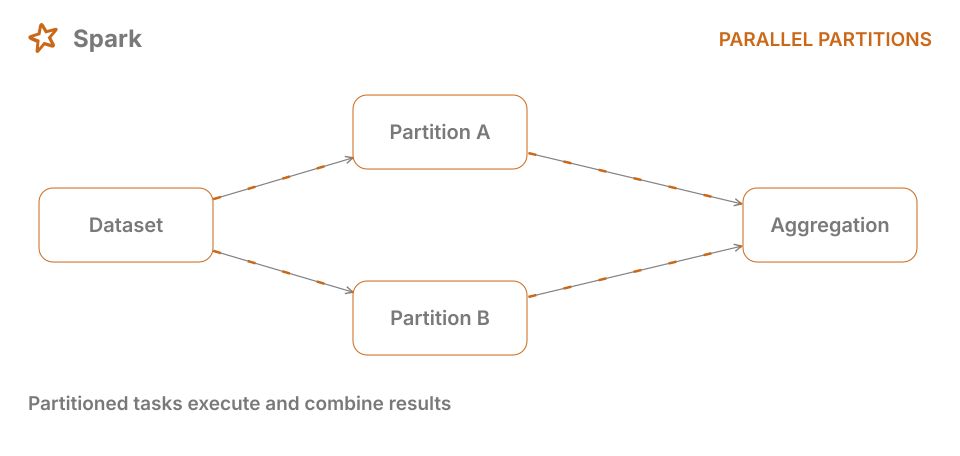
</picture>

</td>
<td width="50%" align="center" valign="top">

<picture>
<source media="(max-width: 600px)" srcset="./assets/workflows/tile-apachekafka-mobile.svg" />

</picture> <strong>Kafka</strong> Partitioned event logs

<picture>
<source media="(max-width: 600px)" srcset="./assets/workflows/04-apachekafka-mobile.svg" />
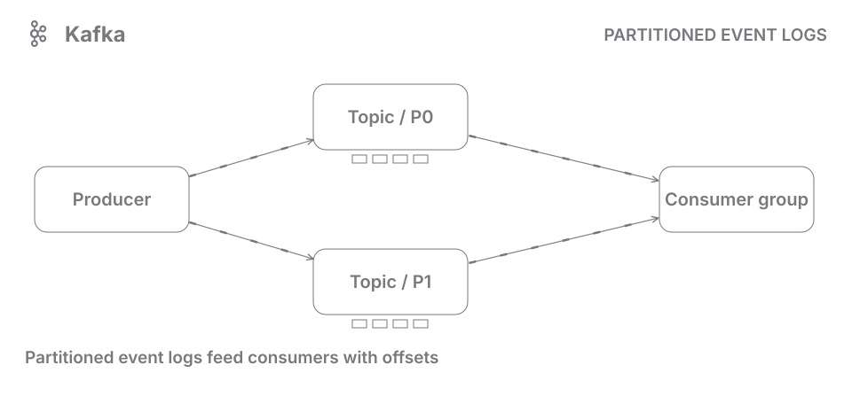
</picture>

</td>
</tr>
<tr>
<td width="50%" align="center" valign="top">

<picture>
<source media="(max-width: 600px)" srcset="./assets/workflows/tile-pandas-mobile.svg" />

</picture> <strong>pandas</strong> Filter and aggregate

<picture>
<source media="(max-width: 600px)" srcset="./assets/workflows/04-pandas-mobile.svg" />
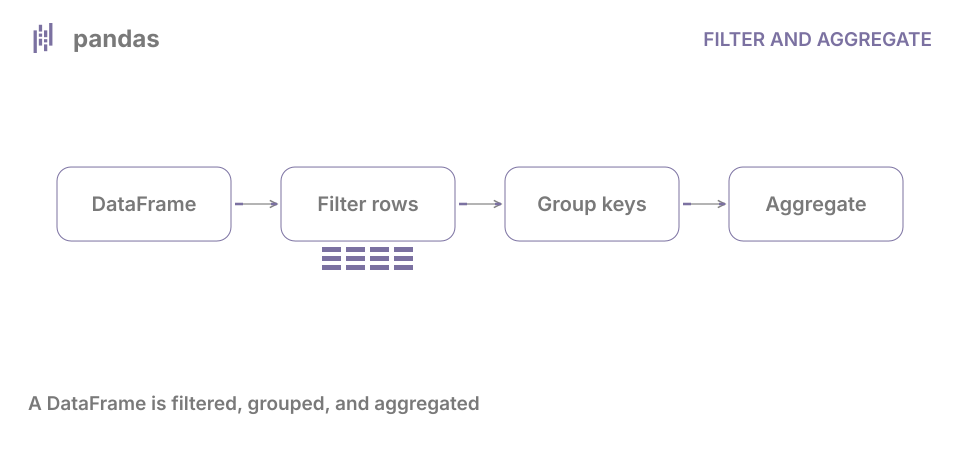
</picture>

</td>
<td width="50%" align="center" valign="top">

<picture>
<source media="(max-width: 600px)" srcset="./assets/workflows/tile-dbt-mobile.svg" />

</picture> <strong>dbt</strong> Model lineage

<picture>
<source media="(max-width: 600px)" srcset="./assets/workflows/04-dbt-mobile.svg" />
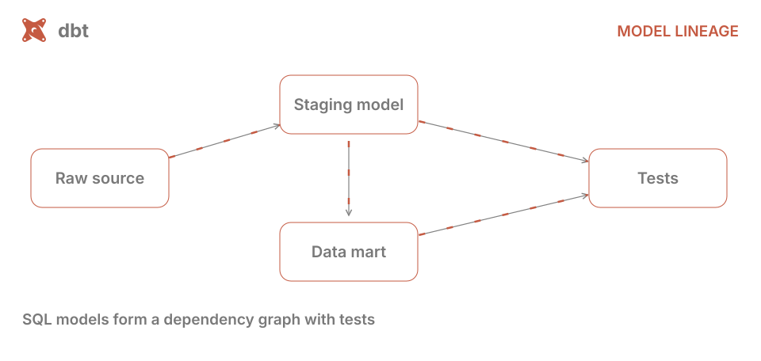
</picture>

</td>
</tr>
<tr>
<td width="50%" align="center" valign="top">

<picture>
<source media="(max-width: 600px)" srcset="./assets/workflows/tile-snowflake-mobile.svg" />

</picture> <strong>Snowflake</strong> Compute and storage

<picture>
<source media="(max-width: 600px)" srcset="./assets/workflows/04-snowflake-mobile.svg" />
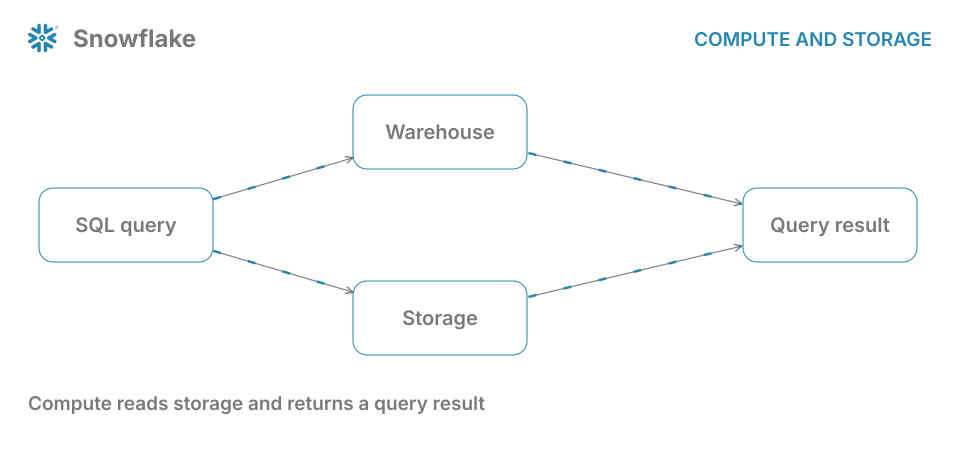
</picture>

</td>
<td width="50%" align="center" valign="top">

<picture>
<source media="(max-width: 600px)" srcset="./assets/workflows/tile-databricks-mobile.svg" />

</picture> <strong>Databricks</strong> Medallion pipeline

<picture>
<source media="(max-width: 600px)" srcset="./assets/workflows/04-databricks-mobile.svg" />
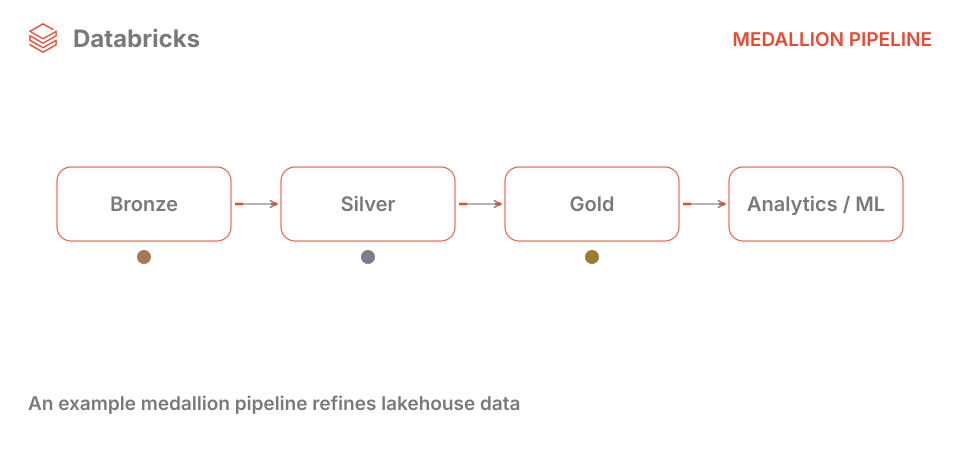
</picture>

</td>
</tr>
<tr>
<td colspan="2" align="center" valign="top">

<picture>
<source media="(max-width: 600px)" srcset="./assets/workflows/tile-postgresql-mobile.svg" />

</picture> <strong>PostgreSQL</strong> Analytical aggregation

<picture>
<source media="(max-width: 600px)" srcset="./assets/workflows/04-postgresql-mobile.svg" />
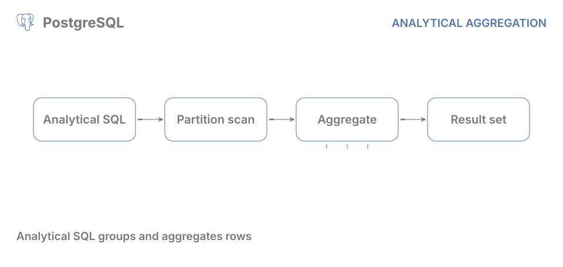
</picture>

</td>
</tr>
</tbody>
</table>

<picture></picture> &nbsp; <strong>2024 - 2026</strong> / Applied AI and agents

<picture>
<source media="(max-width: 600px)" srcset="./assets/workflows/constellation-05-mobile.svg" />
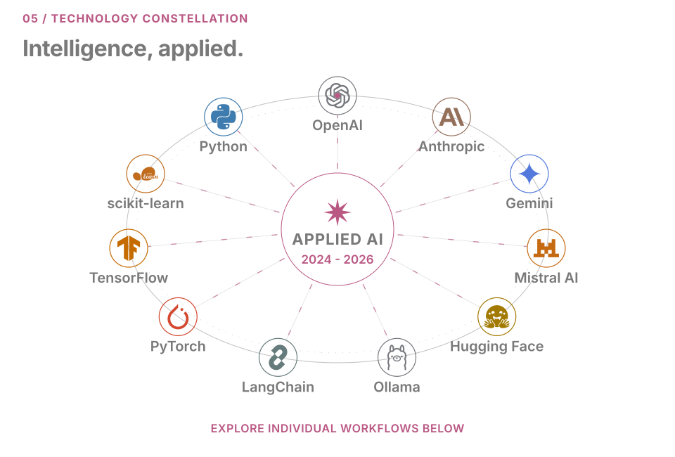
</picture>

<strong>Explore 11 technology workflows</strong>

<table width="100%" align="center">
<tbody>
<tr>
<td width="50%" align="center" valign="top">

<picture>
<source media="(max-width: 600px)" srcset="./assets/workflows/tile-openai-mobile.svg" />

</picture> <strong>OpenAI</strong> Tool-calling loop

<picture>
<source media="(max-width: 600px)" srcset="./assets/workflows/05-openai-mobile.svg" />
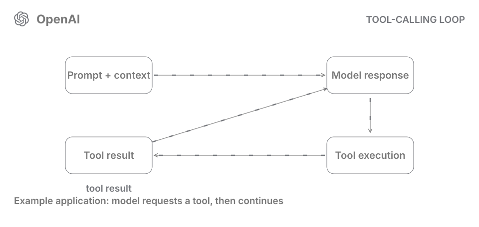
</picture>

</td>
<td width="50%" align="center" valign="top">

<picture>
<source media="(max-width: 600px)" srcset="./assets/workflows/tile-anthropic-mobile.svg" />

</picture> <strong>Anthropic</strong> Tool use and validation

<picture>
<source media="(max-width: 600px)" srcset="./assets/workflows/05-anthropic-mobile.svg" />
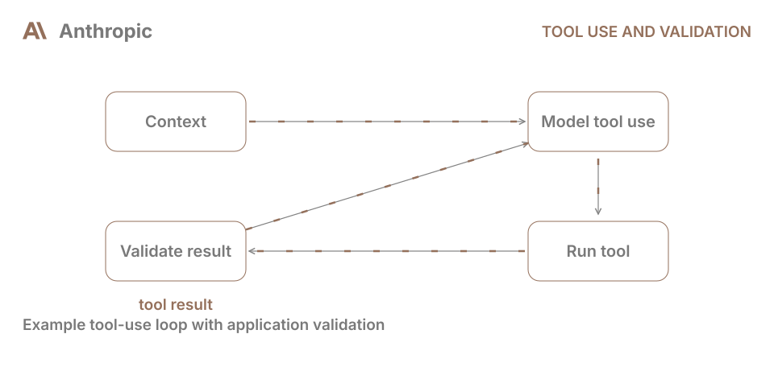
</picture>

</td>
</tr>
<tr>
<td width="50%" align="center" valign="top">

<picture>
<source media="(max-width: 600px)" srcset="./assets/workflows/tile-googlegemini-mobile.svg" />

</picture> <strong>Gemini</strong> Multimodal inputs

<picture>
<source media="(max-width: 600px)" srcset="./assets/workflows/05-googlegemini-mobile.svg" />
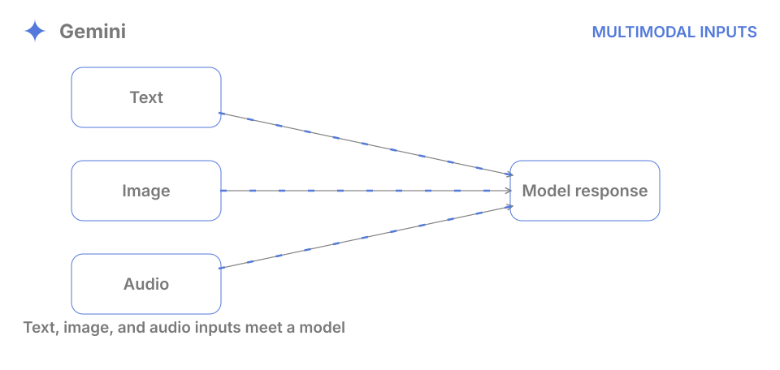
</picture>

</td>
<td width="50%" align="center" valign="top">

<picture>
<source media="(max-width: 600px)" srcset="./assets/workflows/tile-mistralai-mobile.svg" />

</picture> <strong>Mistral AI</strong> Retrieval and generation

<picture>
<source media="(max-width: 600px)" srcset="./assets/workflows/05-mistralai-mobile.svg" />
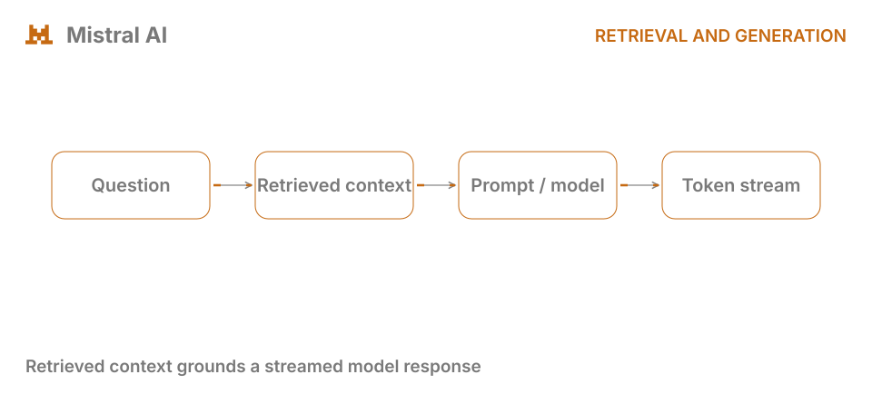
</picture>

</td>
</tr>
<tr>
<td width="50%" align="center" valign="top">

<picture>
<source media="(max-width: 600px)" srcset="./assets/workflows/tile-huggingface-mobile.svg" />

</picture> <strong>Hugging Face</strong> Models and tokenizers

<picture>
<source media="(max-width: 600px)" srcset="./assets/workflows/05-huggingface-mobile.svg" />
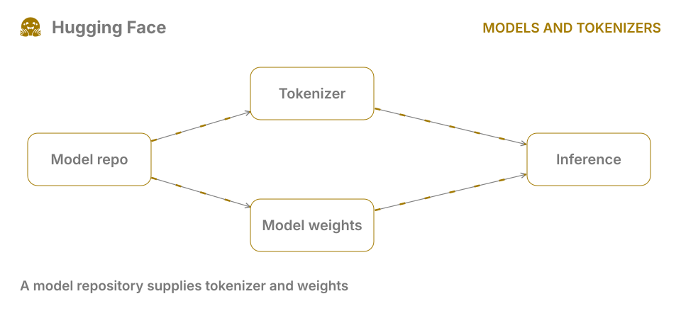
</picture>

</td>
<td width="50%" align="center" valign="top">

<picture>
<source media="(max-width: 600px)" srcset="./assets/workflows/tile-ollama-mobile.svg" />

</picture> <strong>Ollama</strong> Local model runtime

<picture>
<source media="(max-width: 600px)" srcset="./assets/workflows/05-ollama-mobile.svg" />
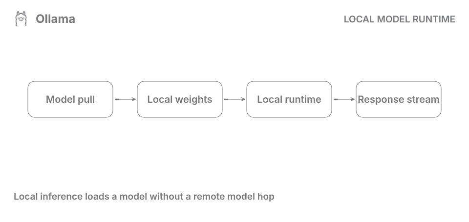
</picture>

</td>
</tr>
<tr>
<td width="50%" align="center" valign="top">

<picture>
<source media="(max-width: 600px)" srcset="./assets/workflows/tile-langchain-mobile.svg" />

</picture> <strong>LangChain</strong> Tools and observations

<picture>
<source media="(max-width: 600px)" srcset="./assets/workflows/05-langchain-mobile.svg" />

</picture>

</td>
<td width="50%" align="center" valign="top">

<picture>
<source media="(max-width: 600px)" srcset="./assets/workflows/tile-pytorch-mobile.svg" />

</picture> <strong>PyTorch</strong> Autograd and optimizer

<picture>
<source media="(max-width: 600px)" srcset="./assets/workflows/05-pytorch-mobile.svg" />

</picture>

</td>
</tr>
<tr>
<td width="50%" align="center" valign="top">

<picture>
<source media="(max-width: 600px)" srcset="./assets/workflows/tile-tensorflow-mobile.svg" />

</picture> <strong>TensorFlow</strong> Train and serve

<picture>
<source media="(max-width: 600px)" srcset="./assets/workflows/05-tensorflow-mobile.svg" />

</picture>

</td>
<td width="50%" align="center" valign="top">

<picture>
<source media="(max-width: 600px)" srcset="./assets/workflows/tile-scikitlearn-mobile.svg" />

</picture> <strong>scikit-learn</strong> Fit and evaluate

<picture>
<source media="(max-width: 600px)" srcset="./assets/workflows/05-scikitlearn-mobile.svg" />

</picture>

</td>
</tr>
<tr>
<td colspan="2" align="center" valign="top">

<picture>
<source media="(max-width: 600px)" srcset="./assets/workflows/tile-python-mobile.svg" />

</picture> <strong>Python</strong> Async model and tool calls

<picture>
<source media="(max-width: 600px)" srcset="./assets/workflows/05-python-mobile.svg" />

</picture>

</td>
</tr>
</tbody>
</table>

