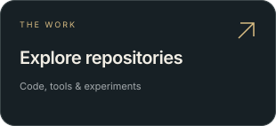
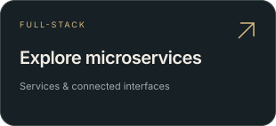
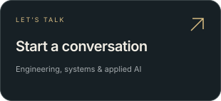

 <picture>
  <source media="(max-width: 600px)" srcset="./assets/hero-mobile.svg" />
  
 </picture>

  <a href="https://github.com/smallpony222?tab=repositories">Explore the work</a> &nbsp; · &nbsp;
  <a href="#the-engineering-journey">The journey</a> &nbsp; · &nbsp;
  <a href="https://github.com/smallpony222/smallpony222/issues/new?title=Let%27s%20connect">Let’s connect</a>

 <picture>
  <source media="(max-width: 600px)" srcset="./assets/journey-mobile.svg" />
  
 </picture>

 <picture>
  <source media="(max-width: 600px)" srcset="./assets/workflow-mobile.svg" />
  
 </picture>

  
  
  

Read the journey in text

- **Before 2017 · Software engineering:** PHP, JavaScript, and web application foundations.
- **2017–2022 · Full-stack engineering:** backend services, cloud architecture, microservices, frontend engineering, and React.
- **2021–2024 · DevOps:** CI/CD, deployments, cloud operations, and maintenance.
- **2023–2025 · Data engineering:** ETL, ELT, orchestration, and data pipelines.
- **2024–2026 · Applied AI:** AI/ML, LLMs, AI-assisted and agentic coding, and agentic workflows.

These are overlapping areas of focus, rather than separate employment dates. Technology marks are representative of the disciplines; they do not claim certifications or vendor affiliations.

Built with intention. Always evolving.

