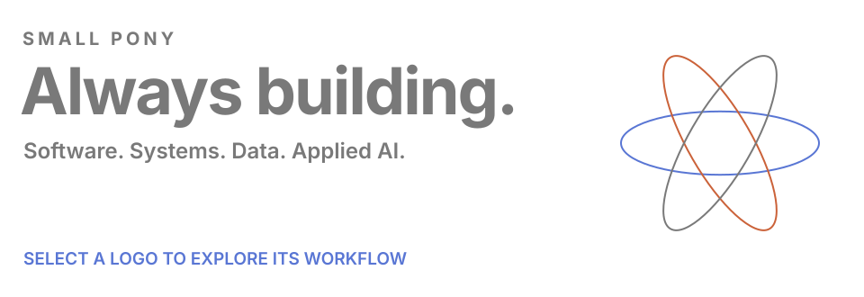

<picture>
<source media="(max-width: 600px)" srcset="./assets/workflows/cover-mobile.svg" />

</picture>

<h2>BEFORE 2017 / The foundations.</h2>

<picture></picture> &nbsp; <strong>PHP</strong> &nbsp; / &nbsp; Request lifecycle

<picture>
<source media="(max-width: 600px)" srcset="./assets/workflows/01-php-mobile.svg" />

</picture>

<picture></picture> &nbsp; <strong>JavaScript</strong> &nbsp; / &nbsp; Event loop

<picture>
<source media="(max-width: 600px)" srcset="./assets/workflows/01-javascript-mobile.svg" />

</picture>

<picture></picture> &nbsp; <strong>HTML5</strong> &nbsp; / &nbsp; Document tree

<picture>
<source media="(max-width: 600px)" srcset="./assets/workflows/01-html5-mobile.svg" />

</picture>

<picture></picture> &nbsp; <strong>CSS</strong> &nbsp; / &nbsp; Style cascade

<picture>
<source media="(max-width: 600px)" srcset="./assets/workflows/01-css-mobile.svg" />

</picture>

<picture></picture> &nbsp; <strong>MySQL</strong> &nbsp; / &nbsp; Indexed reads

<picture>
<source media="(max-width: 600px)" srcset="./assets/workflows/01-mysql-mobile.svg" />

</picture>

<picture></picture> &nbsp; <strong>jQuery</strong> &nbsp; / &nbsp; DOM events

<picture>
<source media="(max-width: 600px)" srcset="./assets/workflows/01-jquery-mobile.svg" />

</picture>

<picture></picture> &nbsp; <strong>Laravel</strong> &nbsp; / &nbsp; Request pipeline

<picture>
<source media="(max-width: 600px)" srcset="./assets/workflows/01-laravel-mobile.svg" />

</picture>

<picture></picture> &nbsp; <strong>Bootstrap</strong> &nbsp; / &nbsp; Responsive grid

<picture>
<source media="(max-width: 600px)" srcset="./assets/workflows/01-bootstrap-mobile.svg" />

</picture>

<h2>2017 - 2022 / Connected systems.</h2>

<picture></picture> &nbsp; <strong>React</strong> &nbsp; / &nbsp; State to DOM

<picture>
<source media="(max-width: 600px)" srcset="./assets/workflows/02-react-mobile.svg" />

</picture>

<picture></picture> &nbsp; <strong>TypeScript</strong> &nbsp; / &nbsp; Type checking

<picture>
<source media="(max-width: 600px)" srcset="./assets/workflows/02-typescript-mobile.svg" />

</picture>

<picture></picture> &nbsp; <strong>Node.js</strong> &nbsp; / &nbsp; Async I/O

<picture>
<source media="(max-width: 600px)" srcset="./assets/workflows/02-nodedotjs-mobile.svg" />

</picture>

<picture></picture> &nbsp; <strong>Next.js</strong> &nbsp; / &nbsp; Server and client rendering

<picture>
<source media="(max-width: 600px)" srcset="./assets/workflows/02-nextdotjs-mobile.svg" />

</picture>

<picture></picture> &nbsp; <strong>GraphQL</strong> &nbsp; / &nbsp; Field resolvers

<picture>
<source media="(max-width: 600px)" srcset="./assets/workflows/02-graphql-mobile.svg" />

</picture>

<picture></picture> &nbsp; <strong>Redis</strong> &nbsp; / &nbsp; Cache hit and miss

<picture>
<source media="(max-width: 600px)" srcset="./assets/workflows/02-redis-mobile.svg" />

</picture>

<picture></picture> &nbsp; <strong>NGINX</strong> &nbsp; / &nbsp; Load balancing

<picture>
<source media="(max-width: 600px)" srcset="./assets/workflows/02-nginx-mobile.svg" />

</picture>

<picture></picture> &nbsp; <strong>MongoDB</strong> &nbsp; / &nbsp; Document queries

<picture>
<source media="(max-width: 600px)" srcset="./assets/workflows/02-mongodb-mobile.svg" />

</picture>

<picture></picture> &nbsp; <strong>PostgreSQL</strong> &nbsp; / &nbsp; Query planning

<picture>
<source media="(max-width: 600px)" srcset="./assets/workflows/02-postgresql-mobile.svg" />

</picture>

<picture></picture> &nbsp; <strong>AWS</strong> &nbsp; / &nbsp; Web architecture

<picture>
<source media="(max-width: 600px)" srcset="./assets/workflows/02-amazonwebservices-mobile.svg" />

</picture>

<picture></picture> &nbsp; <strong>Google Cloud</strong> &nbsp; / &nbsp; Event-driven services

<picture>
<source media="(max-width: 600px)" srcset="./assets/workflows/02-googlecloud-mobile.svg" />

</picture>

<h2>2021 - 2024 / Built to keep running.</h2>

<picture></picture> &nbsp; <strong>Docker</strong> &nbsp; / &nbsp; Image to containers

<picture>
<source media="(max-width: 600px)" srcset="./assets/workflows/03-docker-mobile.svg" />

</picture>

<picture></picture> &nbsp; <strong>Kubernetes</strong> &nbsp; / &nbsp; State reconciliation

<picture>
<source media="(max-width: 600px)" srcset="./assets/workflows/03-kubernetes-mobile.svg" />

</picture>

<picture></picture> &nbsp; <strong>GitHub Actions</strong> &nbsp; / &nbsp; CI/CD jobs

<picture>
<source media="(max-width: 600px)" srcset="./assets/workflows/03-githubactions-mobile.svg" />

</picture>

<picture></picture> &nbsp; <strong>Git</strong> &nbsp; / &nbsp; Branch and merge

<picture>
<source media="(max-width: 600px)" srcset="./assets/workflows/03-git-mobile.svg" />

</picture>

<picture></picture> &nbsp; <strong>GitLab</strong> &nbsp; / &nbsp; Build and deploy

<picture>
<source media="(max-width: 600px)" srcset="./assets/workflows/03-gitlab-mobile.svg" />

</picture>

<picture></picture> &nbsp; <strong>Terraform</strong> &nbsp; / &nbsp; Plan and state

<picture>
<source media="(max-width: 600px)" srcset="./assets/workflows/03-terraform-mobile.svg" />

</picture>

<picture></picture> &nbsp; <strong>Ansible</strong> &nbsp; / &nbsp; Host convergence

<picture>
<source media="(max-width: 600px)" srcset="./assets/workflows/03-ansible-mobile.svg" />

</picture>

<picture></picture> &nbsp; <strong>Linux</strong> &nbsp; / &nbsp; User to kernel

<picture>
<source media="(max-width: 600px)" srcset="./assets/workflows/03-linux-mobile.svg" />

</picture>

<picture></picture> &nbsp; <strong>Prometheus</strong> &nbsp; / &nbsp; Scrape and alert

<picture>
<source media="(max-width: 600px)" srcset="./assets/workflows/03-prometheus-mobile.svg" />

</picture>

<picture></picture> &nbsp; <strong>Grafana</strong> &nbsp; / &nbsp; Query to chart

<picture>
<source media="(max-width: 600px)" srcset="./assets/workflows/03-grafana-mobile.svg" />

</picture>

<h2>2023 - 2025 / Data, in motion.</h2>

<picture></picture> &nbsp; <strong>Python</strong> &nbsp; / &nbsp; Data transformation

<picture>
<source media="(max-width: 600px)" srcset="./assets/workflows/04-python-mobile.svg" />

</picture>

<picture></picture> &nbsp; <strong>Airflow</strong> &nbsp; / &nbsp; Task dependencies

<picture>
<source media="(max-width: 600px)" srcset="./assets/workflows/04-apacheairflow-mobile.svg" />

</picture>

<picture></picture> &nbsp; <strong>Spark</strong> &nbsp; / &nbsp; Parallel partitions

<picture>
<source media="(max-width: 600px)" srcset="./assets/workflows/04-apachespark-mobile.svg" />

</picture>

<picture></picture> &nbsp; <strong>Kafka</strong> &nbsp; / &nbsp; Partitioned event logs

<picture>
<source media="(max-width: 600px)" srcset="./assets/workflows/04-apachekafka-mobile.svg" />

</picture>

<picture></picture> &nbsp; <strong>pandas</strong> &nbsp; / &nbsp; Filter and aggregate

<picture>
<source media="(max-width: 600px)" srcset="./assets/workflows/04-pandas-mobile.svg" />

</picture>

<picture></picture> &nbsp; <strong>dbt</strong> &nbsp; / &nbsp; Model lineage

<picture>
<source media="(max-width: 600px)" srcset="./assets/workflows/04-dbt-mobile.svg" />

</picture>

<picture></picture> &nbsp; <strong>Snowflake</strong> &nbsp; / &nbsp; Compute and storage

<picture>
<source media="(max-width: 600px)" srcset="./assets/workflows/04-snowflake-mobile.svg" />

</picture>

<picture></picture> &nbsp; <strong>Databricks</strong> &nbsp; / &nbsp; Medallion pipeline

<picture>
<source media="(max-width: 600px)" srcset="./assets/workflows/04-databricks-mobile.svg" />

</picture>

<picture></picture> &nbsp; <strong>PostgreSQL</strong> &nbsp; / &nbsp; Analytical aggregation

<picture>
<source media="(max-width: 600px)" srcset="./assets/workflows/04-postgresql-mobile.svg" />

</picture>

<h2>2024 - 2026 / Intelligence, applied.</h2>

<picture></picture> &nbsp; <strong>OpenAI</strong> &nbsp; / &nbsp; Tool-calling loop

<picture>
<source media="(max-width: 600px)" srcset="./assets/workflows/05-openai-mobile.svg" />

</picture>

<picture></picture> &nbsp; <strong>Anthropic</strong> &nbsp; / &nbsp; Tool use and validation

<picture>
<source media="(max-width: 600px)" srcset="./assets/workflows/05-anthropic-mobile.svg" />

</picture>

<picture></picture> &nbsp; <strong>Gemini</strong> &nbsp; / &nbsp; Multimodal inputs

<picture>
<source media="(max-width: 600px)" srcset="./assets/workflows/05-googlegemini-mobile.svg" />

</picture>

<picture></picture> &nbsp; <strong>Mistral AI</strong> &nbsp; / &nbsp; Retrieval and generation

<picture>
<source media="(max-width: 600px)" srcset="./assets/workflows/05-mistralai-mobile.svg" />

</picture>

<picture></picture> &nbsp; <strong>Hugging Face</strong> &nbsp; / &nbsp; Models and tokenizers

<picture>
<source media="(max-width: 600px)" srcset="./assets/workflows/05-huggingface-mobile.svg" />

</picture>

<picture></picture> &nbsp; <strong>Ollama</strong> &nbsp; / &nbsp; Local model runtime

<picture>
<source media="(max-width: 600px)" srcset="./assets/workflows/05-ollama-mobile.svg" />

</picture>

<picture></picture> &nbsp; <strong>LangChain</strong> &nbsp; / &nbsp; Tools and observations

<picture>
<source media="(max-width: 600px)" srcset="./assets/workflows/05-langchain-mobile.svg" />

</picture>

<picture></picture> &nbsp; <strong>PyTorch</strong> &nbsp; / &nbsp; Autograd and optimizer

<picture>
<source media="(max-width: 600px)" srcset="./assets/workflows/05-pytorch-mobile.svg" />

</picture>

<picture></picture> &nbsp; <strong>TensorFlow</strong> &nbsp; / &nbsp; Train and serve

<picture>
<source media="(max-width: 600px)" srcset="./assets/workflows/05-tensorflow-mobile.svg" />

</picture>

<picture></picture> &nbsp; <strong>scikit-learn</strong> &nbsp; / &nbsp; Fit and evaluate

<picture>
<source media="(max-width: 600px)" srcset="./assets/workflows/05-scikitlearn-mobile.svg" />

</picture>

<picture></picture> &nbsp; <strong>Python</strong> &nbsp; / &nbsp; Async model and tool calls

<picture>
<source media="(max-width: 600px)" srcset="./assets/workflows/05-python-mobile.svg" />

</picture>

